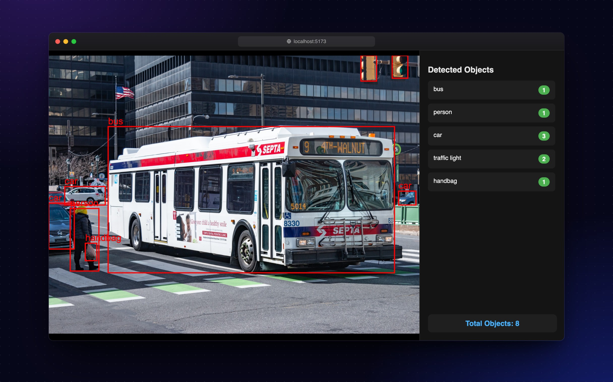
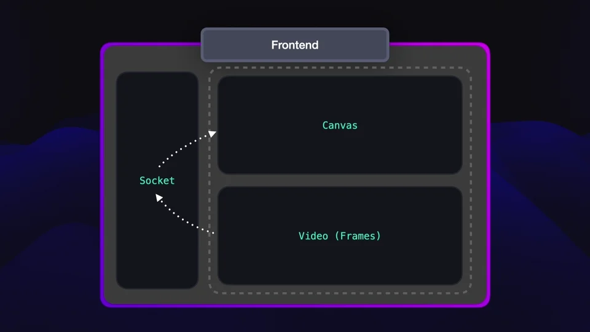
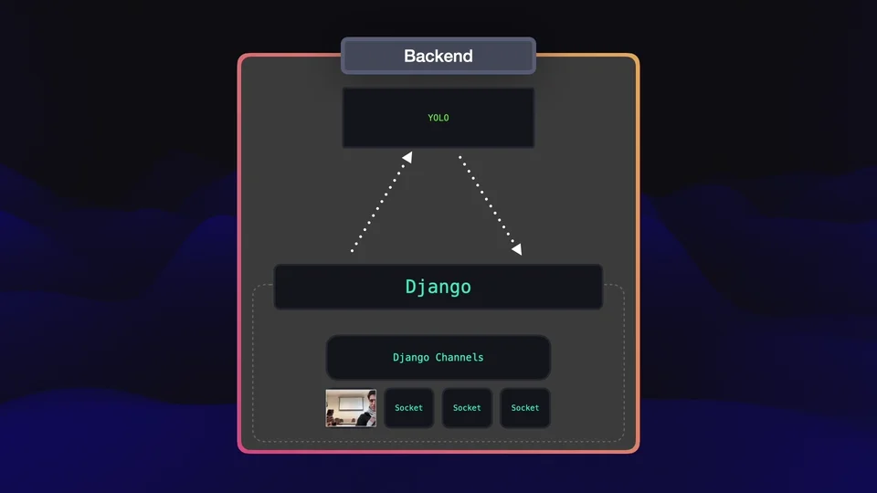
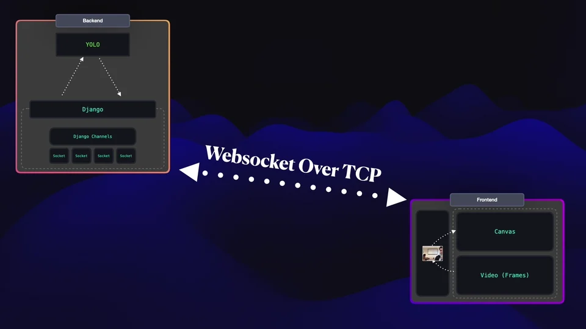

<div align="center">

# Thing Detector

Point a webcam at the world and watch YOLOv8 name what it sees, live in the browser.<br>
Frames stream over a WebSocket to a Django Channels backend, and the detections come back as JSON.

<br>



<sub>Illustration: a street photo stands in for the webcam feed. The boxes are placed by hand and drawn with the app's own canvas code.<br>
Photo by Han Zheng, <a href="https://commons.wikimedia.org/wiki/File:SEPTA_Route_9_-_NFI_DE41LF_-_Market_St._@_22nd_St.jpg">CC BY-SA 2.0</a>, via Wikimedia Commons.</sub>

</div>

## How it works

<sub>The animations come from the slides we presented the project with.</sub>

### 1. The browser streams frames



The React app reads the webcam, draws the current frame to an off-screen canvas, encodes it as JPEG and sends the raw bytes over a WebSocket every 150 ms.

### 2. Django Channels hands each frame to YOLO



`YOLOConsumer` decodes the JPEG with OpenCV and runs YOLOv8n on it (confidence 0.35, on the CPU). Inference runs in a thread pool, so a slow frame doesn't hold up the event loop or the other connections. The model is loaded once, when the server starts.

### 3. The detections come back and get drawn



Each reply is a list of boxes in the pixel coordinates of the frame that was sent:

```json
{
  "type": "detections",
  "detections": [
    { "cls": "bus", "conf": 0.93, "xmin": 102.5, "ymin": 122.5, "xmax": 597.0, "ymax": 375.0 }
  ]
}
```

The frontend draws a box and label for each one on a canvas layered over the live video, and the sidebar counts them by class.

## Run it locally

You'll need Python 3.13 with [uv](https://github.com/astral-sh/uv), Redis, and Node.js.

**1. Redis**, which Django Channels uses as its channel layer:

```bash
redis-server
```

or `docker run -d -p 6379:6379 redis`.

**2. Backend** on port 8000:

```bash
uv sync
cp .env.example .env    # set SECRET_KEY to any random string
uv run python manage.py migrate
uv run python manage.py runserver
```

**3. Frontend** on port 5173:

```bash
cd frontend
cp .env.example .env.local
npm install
npm run dev
```

Open http://localhost:5173 and allow camera access.

Django also serves a single-page fallback at http://localhost:8000/parking/webcam/. It streams at 5 fps and shows confidence next to each label.

## Configuration

| Variable | Where | Default | |
| :-- | :-- | :-- | :-- |
| `SECRET_KEY` | `.env` | | Django secret key |
| `DEBUG` | `.env` | `False` | `.env.example` turns it on for development |
| `ALLOWED_HOSTS` | `.env` | `localhost,127.0.0.1` | Also used to check WebSocket origins |
| `REDIS_HOST`, `REDIS_PORT` | `.env` | `127.0.0.1`, `6379` | |
| `VITE_WS_SCHEME` | `frontend/.env.local` | `wss` | Use `ws` locally |
| `VITE_WS_HOST` | `frontend/.env.local` | `localhost:8000` | Where the backend's `/ws/yolo/` endpoint lives |

To reach it from other devices, serve both apps over HTTPS (browsers only allow webcam access on secure origins) and switch the WebSocket scheme to `wss`. A [Cloudflare Tunnel](https://developers.cloudflare.com/cloudflare-one/networks/connectors/cloudflare-tunnel/) does both without opening ports.

## Troubleshooting

- **Redis connection error.** `redis-cli ping` should answer `PONG`. Check `REDIS_HOST` and `REDIS_PORT` in `.env`.
- **The WebSocket won't connect.** Make sure the backend is running and that `VITE_WS_SCHEME` and `VITE_WS_HOST` point at it.
- **Port already in use.** Run the backend on another port (`runserver 8001`) and update `VITE_WS_HOST` to match.

## Project layout

```text
config/       Django settings and ASGI routing for HTTP and WebSocket
parking/      YOLOConsumer (frame in, detections out) and the /parking/webcam/ page
frontend/     React + Vite app: webcam capture, canvas overlay, detections sidebar
yolov8n.pt    YOLOv8 nano weights
docs/         README images
```

## Team

Made by [Davoud Nosrati](https://github.com/ausdavoud), [Elham Cheraghi](https://github.com/elham-cheraghi), [Mohammad Mallaee](https://github.com/mohammad-mallaee) and Ilia.

## License

[MIT](LICENSE)
